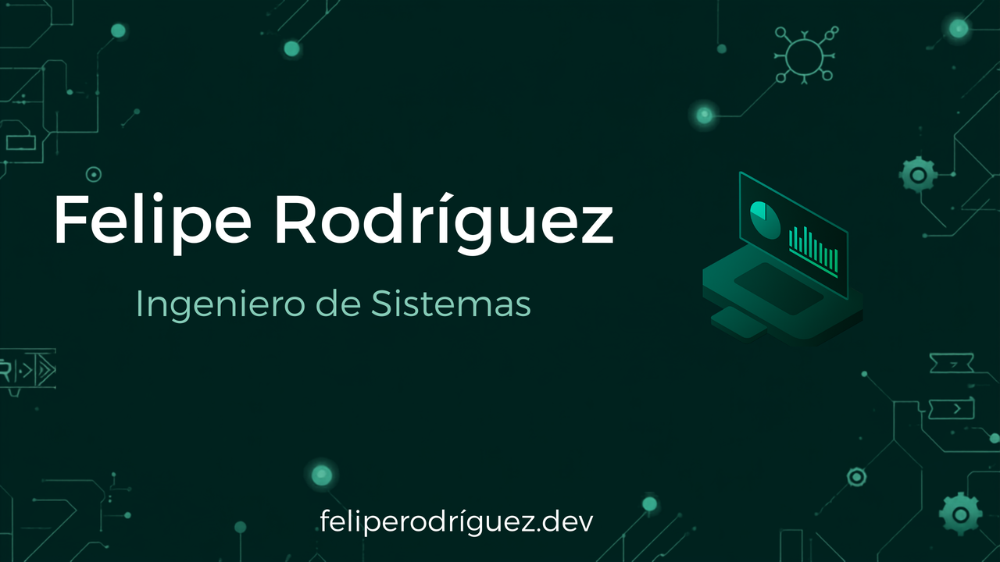

  

<h1 align="center">Hola 👋, soy Felipe Rodriguez</h1>

## 👨‍💻 Sobre mí

Soy estudiante de **Ingeniería de Sistemas** apasionado por el desarrollo de software, la ingeniería de datos y la creación de soluciones tecnológicas automatizadas.

Me caracterizo por ser una persona curiosa, responsable y con una fuerte disposición para aprender. Disfruto enfrentar nuevos desafíos, adquirir conocimientos en diferentes áreas de la tecnología y aplicar buenas prácticas en cada proyecto que desarrollo.

Mi objetivo es seguir creciendo como profesional, participando en proyectos de alto impacto que me permitan aportar valor y continuar ampliando mis habilidades técnicas.

---

# 🛠️ Tecnologías y Herramientas

Estas son algunas de las tecnologías y herramientas con las que he trabajado y continúo fortaleciendo mis conocimientos.

### 💻 Lenguajes de Programación & Consulta

  

### ⚙️ Frameworks y Librerías

  

### 🗄️ Bases de Datos & Data Warehousing

  

### 📊 Business Intelligence, ETL & Inteligencia Artificial

  
  
  &nbsp;
  
  

### 🧰 Herramientas de Desarrollo

  

---

# 📈 Actividad en GitHub

  

---

# 📌 Proyectos Destacados

 
<table> 
<tr> 
<td width="50%" align="center">
📊 <b>ETL & Cloud Data Warehouse Finanzas</b>  

Pipeline End-to-End automatizado con Telegram Bot, Google Gemini AI (PLN), Make.com, Data Warehouse en PostgreSQL (Neon) y Dashboard en Power BI.

 
 
</td> 

<td width="50%" align="center">
🎮 <b>Juego Picas y Fijas</b>  

Juego desarrollado en Java aplicando lógica de programación estructurada, orientación a objetos y manejo de estructuras de control.

  
 
</td> 
</tr> 
</table> 

---

# 🐍 Contribuciones

  <picture>
    <source media="(prefers-color-scheme: dark)" srcset="https://raw.githubusercontent.com/juanfrods/juanfrods/output/github-contribution-grid-snake-dark.svg">
    
  </picture>

  <i>"Siempre aprendiendo, siempre construyendo."</i> 🚀

  <i>"Siempre aprendiendo, siempre construyendo."</i> 🚀

